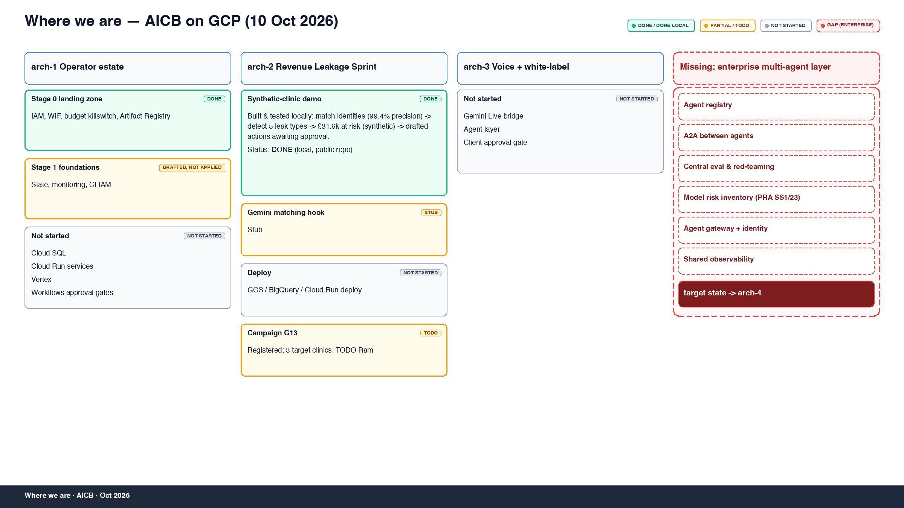
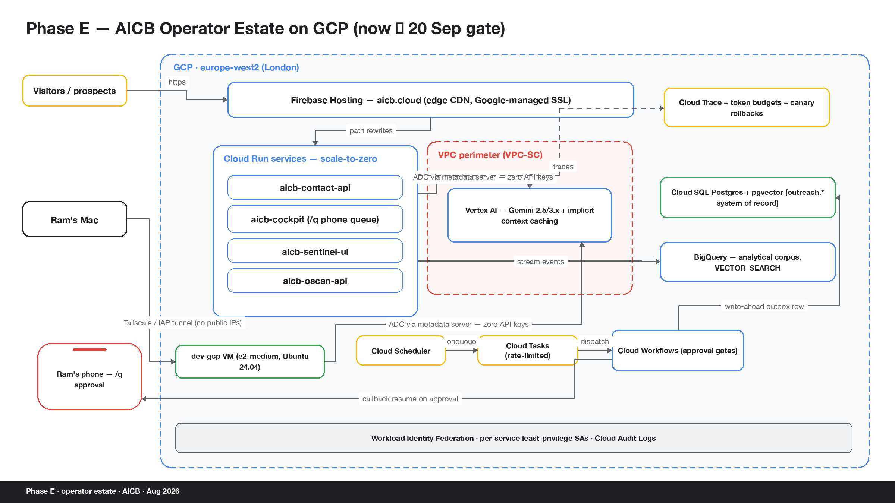
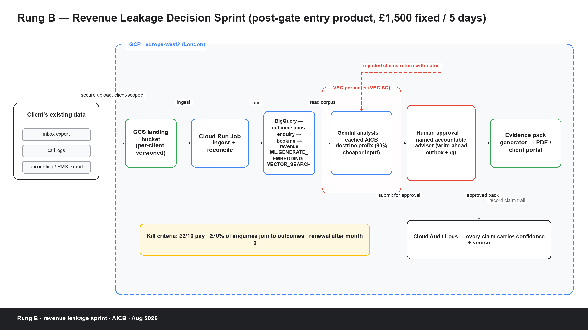
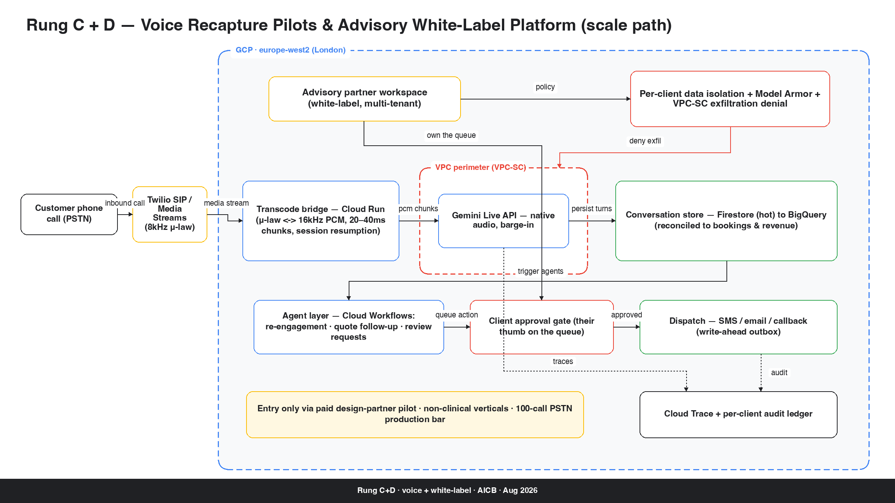
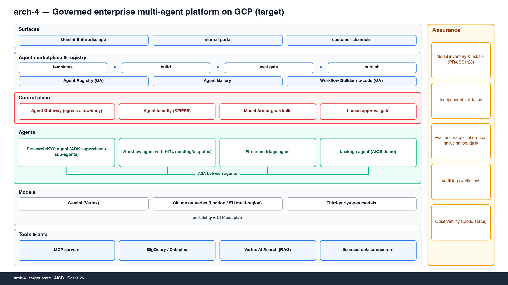
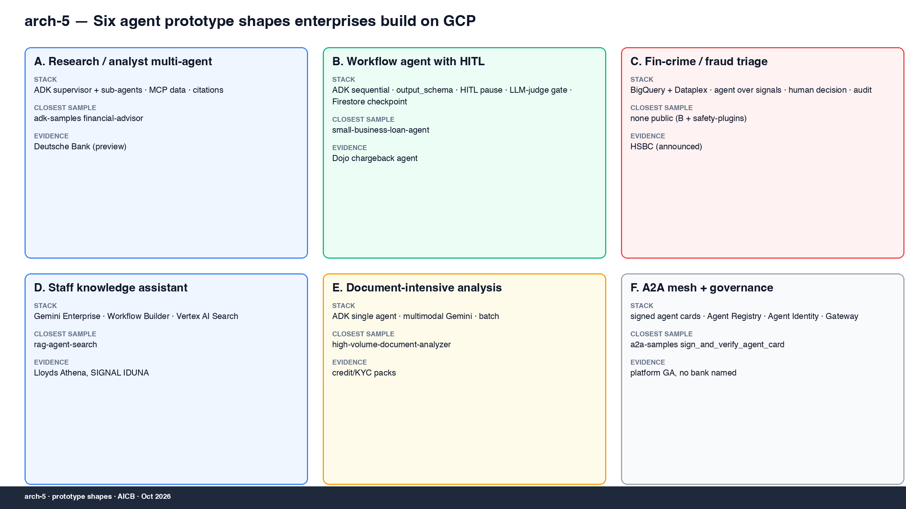

# AICB GCP demos

Small, runnable demos and architecture diagrams from AICB's work on agentic systems on Google Cloud. Each demo is built to be shown, not just described: something you can run, read and react to.

## Demo: enquiry-to-cash leakage

Shows how a small service business loses revenue between the first enquiry and cash in the bank. A synthetic 12-month dataset for a fictional physio clinic is generated, pushed through a leakage pipeline (enquiry to booking to attendance to invoice to payment), and rendered as a report with the leaks ranked by value and a drafted action for each.

Run it (Python 3, standard library for the pipeline):

```
python3 leakage_generate.py && python3 leakage_pipeline.py && python3 leakage_report.py
```

Tests:

```
pytest leakage_test_pipeline.py
```

Outputs: generated `leakage_data_*.json` (git-ignored) and `leakage_report.html` (a pre-built sample is included). More detail in [leakage_README.md](leakage_README.md).

### Synthetic-data caveat

All data is fictional. "Northside Physio" is an invented clinic; names, emails (reserved `example.*` domains) and phone numbers (Ofcom drama range 07700 900xxx) are generated and match no real person or business. The figures illustrate the method and are not benchmarks or findings about any real organisation.

## Diagrams

Regenerate with the matching `render_*.py` script (requires Pillow).



arch-0 — where we are vs the three target architectures (status as of 10 Oct 2026)



Arch 1: the operator estate, how the agent stack and its controls fit together on GCP.



Arch 2: the revenue-leakage sprint, from client data through analysis to an evidence pack.



Arch 3: a white-label voice platform that partners can run under their own brand.



Arch 4: the governed enterprise multi-agent platform on GCP (target state).



Arch 5: six agent prototype shapes enterprises build on GCP.

Background research: [How UK banks are building agents on GCP](ENTERPRISE-AGENTS-GCP.md).

## Licence

MIT, see [LICENSE](LICENSE).
